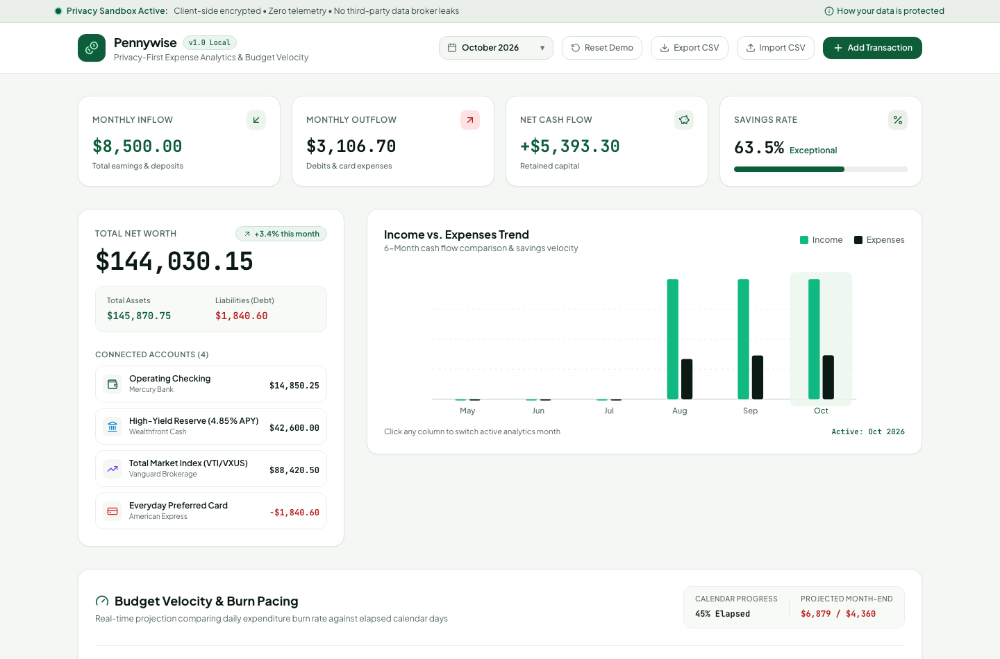
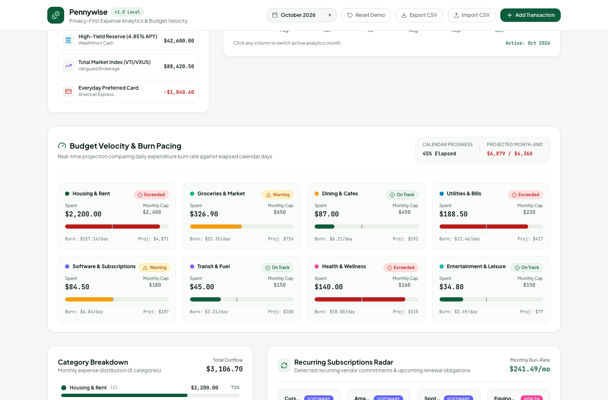
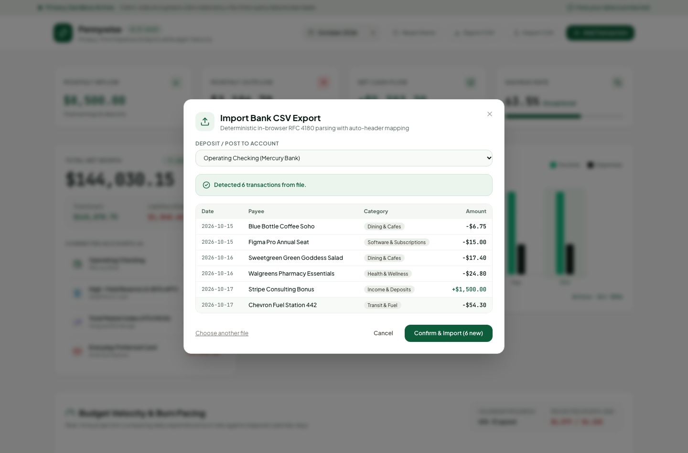
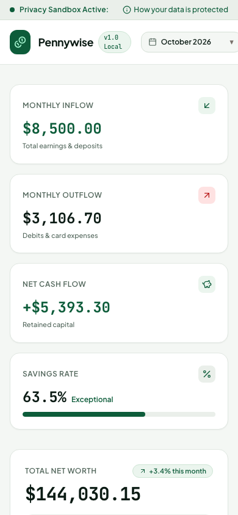

# Pennywise — Privacy-First Expense Analytics & Budget Velocity

[](https://app.netlify.com)
[](https://www.typescriptlang.org/)
[](https://react.dev/)
[](https://tailwindcss.com/)
[](https://vitest.dev/)
[](https://oxc.rs/)

> **Pennywise** is a privacy-first personal finance platform and expense analytics console. Designed on zero-telemetry principles, it computes real-time budget velocity, tracks recurring subscriptions, delivers 6-month historical cash flow trends, and parses bank CSV exports—operating strictly inside the client's browser sandbox with no external server transmission.

---

## Visual Showcase

### Overview Dashboard & 6-Month Cash Flow Trend


### Budget Velocity & Transaction Ledger


### In-Browser RFC 4180 CSV Ingestion Pipeline


### Mobile Responsive Console (iPhone 14)
<p align="left">
  
</p>

---

## Design System & Aesthetic Direction

Inspired by **Mercury**, **Monzo**, and **Wealthfront**:
- **Palette**: Viridian emerald (`#0D5C3A`), deep forest ink (`#0B1B14`), warm sage paper (`#F4F7F4`), and crisp white card containers.
- **Typography**: Dual-typeface hierarchy pairing humanistic grotesque **Plus Jakarta Sans** for interface controls with **JetBrains Mono** tabular figures (`font-feature-settings: 'tnum' 1`) for strict vertical decimal alignment in financial statements.
- **Visual Micro-Interactions**: Dual-bar responsive SVG cash flow charts, calendar progress markers on budget gauges, category distribution pills, and renewal countdown badges.

---

## Key Technical Features

### 1. Budget Velocity & Burn Pacing Engine
Traditional personal budgeting apps fail because they inform users only after a monthly limit is breached. Pennywise computes real-time burn velocity:
$$\text{Daily Burn} = \frac{\text{Spent to Date}}{D_{\text{elapsed}}}$$
$$\text{Projected Month-End Spend} = \text{Daily Burn} \times D_{\text{total}}$$
Visual dual-indicator gauges compare the spend fill bar against a vertical marker representing the current day of the month ($D_{\text{elapsed}} / D_{\text{total}}$), warning users if expenditure is pacing to exceed budget before month's end.

### 2. Client-Side RFC 4180 CSV Pipeline
- Full tokenizer supporting quoted values, internal commas, and escaped double quotes (`""`).
- Header auto-detection for standard bank exports (Chase, Mercury, Amex, Apple Card, Monzo).
- Heuristic merchant category classifier (e.g. "Trader Joe's" $\to$ `groceries`, "Cursor AI" $\to$ `software`, "ConEdison" $\to$ `utilities`).
- In-memory CSV generation and zero-server download using `Blob` and temporal object URLs.
- Duplicate transaction detection fingerprinting (`date + payee + amount`).

### 3. Net Worth & Liquidity Overview
- Computes aggregate net worth across liquid checking, high-yield cash reserves, total market index portfolios, and credit card liabilities.
- Month-over-month delta tracking and individual account status.

### 4. Zero-Telemetry Local Sandbox
- Zero tracking pixels, zero analytics beacons, zero third-party Plaid/Yodlee broker APIs.
- Fully sandboxed inside browser `localStorage` under `pennywise_finance_v1`.
- 1-click **Reset Demo Data** restoring realistic 90-day multi-account financial fixtures.

---

## Tech Stack

| Layer | Technology |
|---|---|
| **Framework** | React 19 + TypeScript 5.8 (Strict Mode, `verbatimModuleSyntax`) |
| **Build Tool** | Vite 6 |
| **Styling** | Tailwind CSS v4 |
| **State Management** | Zustand 5 (with client-side `localStorage` persistence) |
| **Typography** | Plus Jakarta Sans & JetBrains Mono |
| **Icons** | Lucide React |
| **Testing** | Vitest 5 + Testing Library |
| **Linter** | Oxlint (0 warnings, 0 errors) |
| **Deployment** | Netlify (`netlify.toml` with SPA redirects and security headers) |

---

## Directory Structure

```
pennywise-expense-analytics/
├── docs/
│   ├── architecture.md             # Data model, math equations, CSV pipeline & privacy
│   └── design-research.md          # Fintech design system, palette, and typography
├── screenshots/
│   ├── desktop-home.png            # Desktop overview with cash flow & net worth
│   ├── desktop-main-feature.png    # Budget velocity gauges and transaction ledger
│   ├── desktop-import-modal.png    # RFC 4180 CSV ingestion modal with preview table
│   └── mobile-home.png             # Mobile responsive viewport (390x844)
├── scripts/
│   └── capture-screenshots.ts      # Automated Playwright capture script
├── src/
│   ├── components/
│   │   ├── budgets/
│   │   │   └── BudgetVelocitySection.tsx # Burn rate pacing gauges & inline editing
│   │   ├── dashboard/
│   │   │   ├── CashFlowChart.tsx   # 6-Month dual-bar responsive SVG chart
│   │   │   ├── CashFlowSummary.tsx # Inflow, outflow, net savings, and savings rate
│   │   │   ├── CategorySpendChart.tsx # Category distribution progress bars
│   │   │   └── NetWorthCard.tsx    # Total net worth and connected accounts
│   │   ├── import/
│   │   │   └── CSVImportModal.tsx  # In-browser CSV parser & duplicate detector
│   │   ├── layout/
│   │   │   ├── Footer.tsx          # Privacy guarantee & local sandbox info
│   │   │   ├── Header.tsx          # Month switcher, demo reset, CSV export/import
│   │   │   └── PrivacyBanner.tsx   # Local sovereign sandbox indicator
│   │   ├── subscriptions/
│   │   │   └── RecurringRadar.tsx  # Recurring vendor radar with renewal countdowns
│   │   └── transactions/
│   │       ├── AddTransactionModal.tsx # Inflow/outflow manual recorder
│   │       └── TransactionTable.tsx    # Filterable and searchable ledger
│   ├── data/
│   │   └── seedData.ts             # 90-day banking fixtures & recurring subscriptions
│   ├── lib/
│   │   ├── csvParser.ts            # RFC 4180 parser & category heuristics
│   │   └── financialMath.ts        # Net worth, cash flow, budget velocity math
│   ├── store/
│   │   └── financeStore.ts         # Zustand store with localStorage persistence
│   ├── types/
│   │   └── finance.ts              # TypeScript domain interfaces
│   ├── App.tsx                     # Top-level composition
│   ├── index.css                   # Tailwind v4 configuration
│   └── main.tsx                    # Application entry point
├── tests/
│   ├── csvParser.test.ts           # Tokenizer, header detection, and CSV export
│   ├── financeStore.test.ts        # Account balance mutations & deduplication
│   ├── financialMath.test.ts       # Net worth, cash flow, and velocity math
│   └── setup.ts                    # Vitest test setup
├── netlify.toml                    # Netlify production configuration
├── package.json
└── vite.config.ts
```

---

## Verification & Testing Matrix

Pennywise maintains **100% test passing** and **zero lint warnings**:

```bash
# Run unit tests
pnpm test

# Run linter
pnpm lint

# Run type checker and production build
pnpm build
```

### Test Suite Summary:
- `tests/financialMath.test.ts` (6 tests): Net worth aggregation, cash flow calculations, category distribution sorting, budget velocity projection, and recurring detection.
- `tests/csvParser.test.ts` (5 tests): Tokenization with quotes/commas, merchant category inference, header column detection, raw CSV parsing, and RFC 4180 export.
- `tests/financeStore.test.ts` (5 tests): Initial hydration, transaction addition with account balance syncing, transaction deletion, budget limit adjustment, and CSV import deduplication.
- **Total: 16 tests passing in <750ms**.

---

## Deployment to Netlify

Configured for zero-config Netlify continuous deployment via `netlify.toml`:

```toml
[build]
  command = "pnpm build"
  publish = "dist"

[[redirects]]
  from = "/*"
  to = "/index.html"
  status = 200
```

To deploy via Netlify CLI:
```bash
netlify deploy --build --prod
```

---

## License

MIT © 2026 Abderraouf SAHEB
