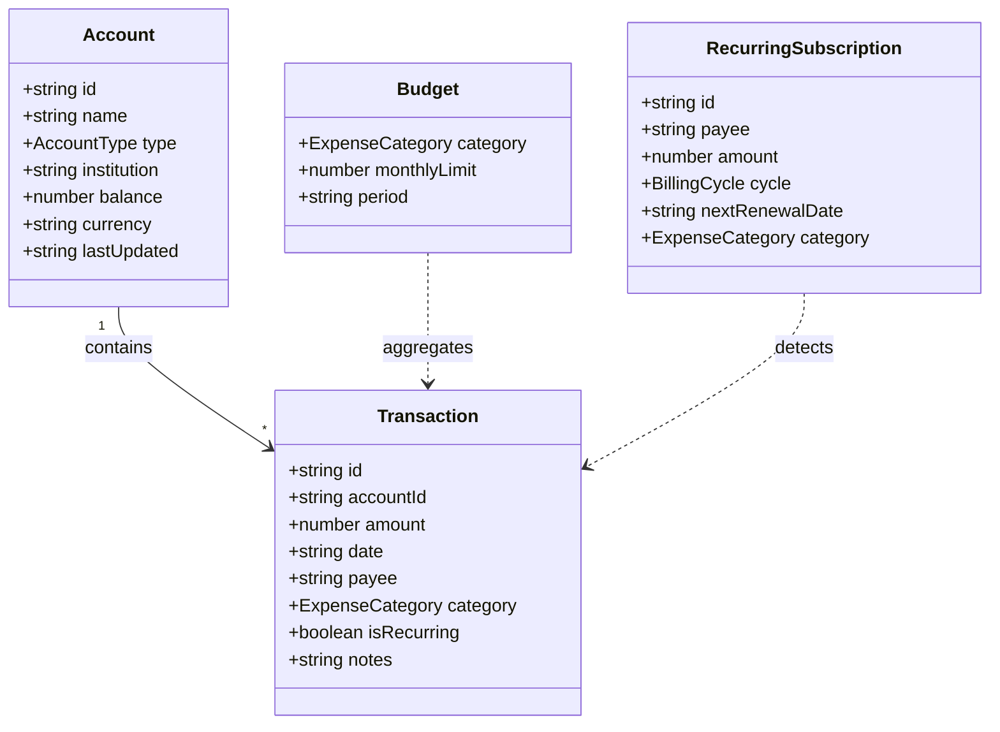

# Pennywise — Architecture & Technical Specifications

## 1. Executive Summary

Pennywise is a zero-telemetry, privacy-first personal finance and expense analytics platform designed to solve two core problems in consumer fintech:
1. **Financial Privacy**: Modern budgeting apps frequently link directly to third-party data brokers (Plaid, Yodlee) and monetize user transaction data. Pennywise executes 100% in-browser with zero server telemetry or remote data storage.
2. **Actionable Budget Velocity**: Static budgets fail because they don't warn users until the budget is already broken. Pennywise calculates **daily burn velocity** and projects month-end variance based on elapsed days.

---

## 2. Domain Data Architecture

### Core Type Definitions (`src/types/finance.ts`):
- `AccountType`: `'checking' | 'savings' | 'investment' | 'credit'`
- `ExpenseCategory`: `'housing' | 'groceries' | 'dining' | 'utilities' | 'software' | 'transit' | 'health' | 'entertainment' | 'income' | 'other'`
- `BillingCycle`: `'monthly' | 'yearly'`

---

## 3. Financial Mathematics Engine

### A. Net Worth Computation
$$\text{Net Worth} = \sum_{a \in \text{Assets}} a.\text{balance} - \sum_{l \in \text{Liabilities}} |l.\text{balance}|$$
Where assets are `checking`, `savings`, and `investment` accounts, and liabilities are `credit` accounts with outstanding balances.

### B. Cash Flow & Savings Rate
$$\text{Monthly Income} = \sum_{t \in \text{Income}} t.\text{amount}$$
$$\text{Monthly Expenses} = \sum_{t \in \text{Expenses}} |t.\text{amount}|$$
$$\text{Net Savings} = \text{Income} - \text{Expenses}$$
$$\text{Savings Rate} = \begin{cases} \left(\frac{\text{Net Savings}}{\text{Income}}\right) \times 100\%, & \text{if Income} > 0 \\ 0\%, & \text{otherwise} \end{cases}$$

### C. Budget Velocity & Pacing Equation
Given $D_{\text{elapsed}}$ days past in month of $D_{\text{total}}$ days:
$$\text{Daily Burn} = \frac{\text{Spent to Date}}{D_{\text{elapsed}}}$$
$$\text{Projected Month-End Spend} = \text{Daily Burn} \times D_{\text{total}}$$
$$\text{Pacing Ratio} = \frac{\text{Projected Spend}}{\text{Monthly Limit}}$$

Pacing status:
- **`on-track`**: Pacing Ratio $\le 1.0$ (Spend pacing within budget)
- **`warning`**: Pacing Ratio $> 1.0$ and $\le 1.15$ (Pacing to exceed limit by up to 15%)
- **`exceeded`**: Current Spend $\ge \text{Monthly Limit}$ or Pacing Ratio $> 1.15$

---

## 4. RFC 4180 CSV Ingestion Pipeline

The client-side CSV parser supports standard bank exports (Chase, Amex, Bank of America, Monzo, Mercury):
1. **Tokenizer**: Handles quoted strings, internal commas, escaped double quotes (`""`), and newline normalizations (`\r\n` $\to$ `\n`).
2. **Header Auto-Detection**:
   - `Date`: Matches `date`, `posted date`, `transaction date`, `time`
   - `Amount`: Matches `amount`, `debit`, `total`, `value`
   - `Payee`: Matches `payee`, `description`, `merchant`, `name`
   - `Category`: Matches `category`, `classification`, `type`
3. **Interactive Column Mapping**: If ambiguous, the UI presents an interactive mapping dropdown.
4. **Validation & Deduplication**: Rejects rows missing date or amount, converts negative debit representations, and matches against existing transaction fingerprints (`date + payee + amount`).

---

## 5. Security & Privacy Sandbox

- **Zero-Telemetry Principle**: No Google Analytics, no tracking beacons, no Sentry telemetry.
- **Client-Side Persistence**: State is stored strictly inside `localStorage` under key `pennywise_finance_v1`.
- **Export Integrity**: CSV files are assembled in memory as UTF-8 encoded `Blob`s and downloaded via temporal `<a download="...">` anchors, with zero data leaving the browser sandbox.
